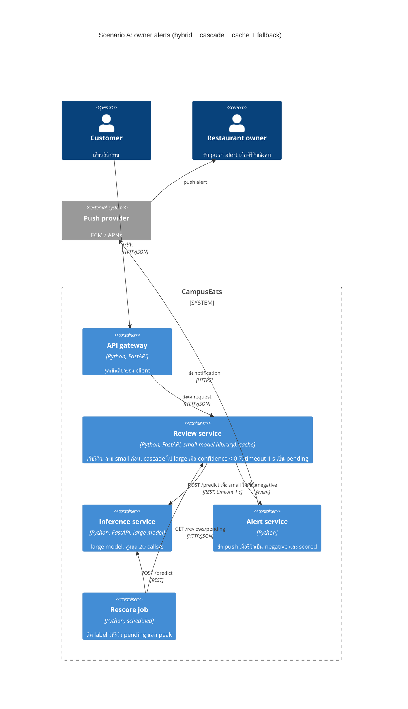

# Task 4: Deployment topologies and trade-offs

**Name / ชื่อ:** ธรา วรานุเศรษฐ์

**Student ID / รหัสนิสิต:** 6630132921

This is **individual work**: each student completes and submits their own copy, in their own fork.

*งานนี้เป็น**งานเดี่ยว** นิสิตแต่ละคนทำและส่งงานของตัวเอง ใน fork ของตัวเอง*

**Scenario (A, B or C) / Scenario ที่เลือก:** A (Owner alerts)

Choose **one** scenario below. If the last digit of your student ID is odd, take A or B; if it is even, take B or C. Use your measurements from Tutorial 6 as evidence: cite run names from `results/runs.csv`. Answer in Thai or English.

เลือก scenario **หนึ่ง** ข้อด้านล่าง ถ้าเลขตัวสุดท้ายของรหัสนิสิตเป็นเลขคี่ ให้เลือก A หรือ B ถ้าเป็นเลขคู่ ให้เลือก B หรือ C ใช้ผลการวัดจาก tutorial ที่ทำไปเป็นข้อมูลอ้างอิง โดยอ้างชื่อ run จาก `results/runs.csv` จะตอบเป็นภาษาไทยหรือภาษาอังกฤษก็ได้

Facts that hold in every scenario / ข้อเท็จจริงที่ใช้กับทุก scenario:

- The large model serves at most **20 calls per second** (4 calls at once × about 200 ms each), and every call costs money.

  *large model รับได้สูงสุด **20 calls ต่อวินาที** (พร้อมกัน 4 calls × ประมาณ 200 ms ต่อ call) และทุก call มีค่าใช้จ่าย*
- The small model is fast and cheap enough to run anywhere, including inside the review service or on a kiosk, but it is much less accurate on its own.

  *small model เร็วและถูกพอที่จะรันที่ไหนก็ได้ รวมถึงภายใน review service หรือบน kiosk แต่ถ้าใช้ตัวเดียวจะแม่นน้อยกว่ามาก*

## Scenarios

**A. Owner alerts.** When a customer posts a negative review, the restaurant owner gets a push notification within **2 seconds**. At the lunch peak, CampusEats receives **40 reviews per second**. A missed alert is acceptable, but a wrong alert (for example, "your customer is unhappy" when they are happy) makes owners stop trusting alerts and, in the end, ignore them.

*เมื่อลูกค้าโพสต์รีวิวเชิงลบ เจ้าของร้านจะต้องได้รับ push notification ภายใน **2 วินาที** เวลาช่วงพีคตอนเที่ยง CampusEats ได้รับรีวิวจำนวน **40 รายการต่อวินาที** การพลาด alert ไปบ้างนั้นยอมรับได้ แต่ alert ที่ผิด (เช่น "ลูกค้าไม่พอใจ" ทั้งที่จริงๆ แล้วพอใจ) จะทำให้เจ้าของร้านไม่เชื่อถือและเลิกสนใจ alert ในที่สุด*

**B. Canteen kiosk.** A tablet in each canteen lets students leave a review on the spot. However, the canteen Wi-Fi is poor: the tablets lose their connection several times a day, for minutes at a time. The system must accept every review, even while a tablet is offline. Restaurant owners need the labels **by the end of the day**.

*มี tablet ในแต่ละโรงอาหารให้นิสิตรีวิวได้ทันที อย่างไรก็ดี การเชื่อมต่อ Wi-Fi ในโรงอาหารไม่ดี ทำให้ tablet หลุดการเชื่อมต่อวันละหลายครั้ง ครั้งละหลายนาที ระบบจะต้องรับรีวิวได้ทุกรายการแม้ขณะที่กำลัง offline อยู่ และเจ้าของร้านต้องการ label **ภายในสิ้นวัน***

**C. Weekly report.** Restaurant owners want a weekly sentiment report. Nothing in producing this report has to be real-time. **Accuracy matters most** and **cost must be minimal**.

*เจ้าของร้านต้องการรายงาน sentiment รายสัปดาห์ ไม่มีอะไรที่จะต้องทำแบบ real-time ในการออกรายงานนี้ ความแม่นยำ **(accuracy) สำคัญที่สุด** และ **ค่าใช้จ่ายต้องน้อยที่สุด***

## Topologies and patterns to choose from / Topology และ pattern ที่เลือกใช้ได้

| | Topology | Where the model runs / โมเดลรันที่ไหน |
|---|---|---|
| T1 | Model as a service, synchronous | Inference service, called for each review (today's baseline) *inference service ถูกเรียกทุกรีวิว (baseline ของวันนี้)* |
| T2 | Model as a library | Inside the review service, or on the device *ภายใน review service หรือบนอุปกรณ์* |
| T3 | Hybrid | Small model locally, large model as a remote service *small model รันในเครื่อง large model เป็น remote service* |
| T4 | Asynchronous / batch | Reviews are queued (broker, W10) or stored, and scored later in bulk *รีวิวถูกเข้าคิว (broker, W10) หรือเก็บไว้ แล้วติด label ทีหลังเป็นชุด* |

Combine one topology with any of the patterns from Tutorial 6: **fallback**, **cascade** and **cache**.

*เลือก topology หนึ่งแบบ แล้วผสมกับ pattern จาก Tutorial 6 ได้ตามต้องการ: **fallback**, **cascade** และ **cache***

## 1. Quality requirements

The three most important quality requirements for your scenario, each with a number where possible.

*quality requirements ที่สำคัญที่สุด 3 ข้อของ scenario ที่เลือก ระบุตัวเลขเมื่อทำได้*

| # | Quality | Requirement |
|---|---|---|
| 1 | Performance | 95% ของรีวิวเชิงลบต้องส่ง push alert ถึงเจ้าของร้านภายใน 2 s ที่ peak 40 reviews/s |
| 2 | Capacity / Cost | ที่ peak ต้องเรียก large model ไม่เกิน 20 calls/s (เป้าไม่เกิน 16 calls/s เผื่อ 20%) |
| 3 | Accuracy (alert ถูกต้อง) | label ถูกอย่างน้อย 90% และไม่ส่ง alert จากผลที่ไม่แน่ใจ ยอมพลาด alert ดีกว่าส่งผิด |

## 2. Design / การออกแบบ

Your topology, the patterns you add, and a container-level diagram (C4 level 2). The C4 diagram must be written in Mermaid.

*topology ที่เลือก pattern ที่เพิ่ม และ diagram ระดับ container (C4 level 2) เขียนด้วย Mermaid*

> Topology **T3 Hybrid**: small model รันใน review service (library) large model เป็น remote inference service
> Patterns: **cascade** threshold 0.7, **cache** (key มี model version), **fallback** timeout 1 s เป็น pending ไม่ส่ง alert และให้ batch job ติด label ทีหลัง
> Alert ส่งเฉพาะรีวิวที่ label เป็น negative และ scored เท่านั้น pending ไม่ส่ง

## 3. Evidence / หลักฐาน

Which runs support your choice? Show the numbers and, for scenario A, the capacity arithmetic: how many large-model calls per second does your design need at the peak?

*run ไหนที่สนับสนุนการตัดสินใจของนิสิต ให้นิสิตแสดงตัวเลขประกอบ และสำหรับ scenario A ให้นิสิตแสดงการคำนวณ capacity ด้วย เพื่อแสดงว่าในช่วงพีคนั้น design ของนิสิตต้องใช้ large model กี่ calls ต่อวินาที*

| Run | What it shows / แสดงอะไร |
|---|---|
| t0-large | large ล้วน: acc 93.5%, large_calls 100%, p50 505 ms, p95 613 ms |
| t0-small | small ล้วน: acc 72.5%, large_calls 0%, p50 30 ms, p95 67 ms |
| t1-after | timeout 1 s + fallback ภายใต้ hang 10%: errors 0, pending 20, p95 1016 ms |
| t2-0.6 | cascade 0.6: acc 91.5%, large_calls 38%, p50 17 ms, p95 551 ms |
| t2-0.7 | cascade 0.7: acc 93.0%, large_calls 53%, p50 368 ms, p95 627 ms |
| t2-0.8 | cascade 0.8: acc 93.5%, large_calls 64%, p95 644 ms |
| t2-0.9 | cascade 0.9: acc 93.5%, large_calls 77%, p95 582 ms |
| t3-cache | cascade 0.7 + cache: acc 93.0%, large_calls 38%, cache_hits 35%, p50 11 ms, p95 548 ms |

> design นี้ใช้ large 40 x 38% = 15.2 calls/s (t3-cache) ต่ำกว่า 20, acc 93.0%, p95 548 ms ต่ำกว่า 2 s

## 4. ADR

Use the ADR format from W5.

*ใช้รูปแบบ ADR จาก W5*

**Title:** ใช้ hybrid topology กับ cascade 0.7, cache และ fallback สำหรับ owner alerts

**Status:** Proposed

**Context:** ต้องส่ง alert รีวิวเชิงลบภายใน 2 s ที่ peak 40 reviews/s แต่ large model รับได้แค่ 20 calls/s และทุก call มี cost ถ้าใช้ large ล้วนจะต้องใช้ 40 calls/s (t0-large) ส่วน small ล้วนแม่นแค่ 72.5% (t0-small) ซึ่งทำให้ alert ผิดบ่อย และ large อาจค้างได้ (t1-before errors 18)

**Decision:** รัน small model ใน review service ถาม small ก่อน ส่งไป large เฉพาะเมื่อ confidence < 0.7 ใช้ cache ที่มี model version ใน key เรียก large ด้วย timeout 1 s ถ้า timeout ให้บันทึก pending ไม่ส่ง alert และให้ batch job ติด label ทีหลัง

**Consequences:**
- Positive: large 15.2 calls/s ที่ peak อยู่ใน capacity (t3-cache), acc 93.0% ผ่าน QR3, p95 548 ms อยู่ใน 2 s, large ค้างไม่ทำให้รีวิวหายหรือ error (t1-after errors 0)
- Negative: small model ผูกกับ review service ต้อง deploy ใหม่เมื่อเปลี่ยนโมเดล, รีวิวที่ timeout ไม่ได้ alert (missed alert), cache hit rate 35% ขึ้นกับรีวิวซ้ำ ถ้ารีวิวซ้ำน้อยลง large จะกลับไปที่ 21.2 calls/s เกิน capacity เล็กน้อย, small ที่มั่นใจแต่ผิด (เช่น "not bad") ยังทำให้เกิด alert ผิดได้

**Alternatives considered:** 
- T1 large ล้วน: แม่นสุด 93.5% แต่ต้องใช้ 40 calls/s เกิน capacity 2 เท่า คิวจะยาวจนเกิน 2 s
- T2 small ล้วน: เร็วและไม่มี cost แต่ acc 72.5% ทำให้ alert ผิดบ่อย เจ้าของร้านเลิกเชื่อ
- T4 batch: ประหยัดที่สุด แต่ส่ง alert ภายใน 2 s ไม่ได้
